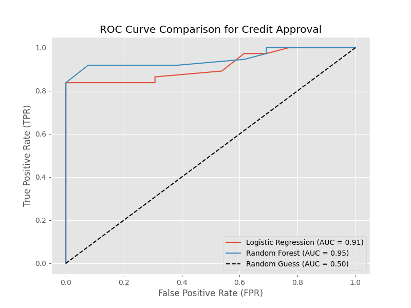
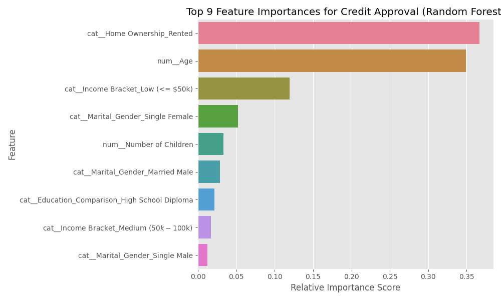

# Credit Approval Prediction Model

**Objective:** To predict credit approval likelihood (Approved vs. Not Approved) based on demographic and financial indicators using machine learning classification models.

## Business Case
Lending institutions need robust, interpretable methods to assess creditworthiness. This project builds a predictive pipeline that classifies applicants into credit-approved categories based on underlying features such as income brackets, age, and home ownership, allowing for automated risk assessment.

## Dataset & Methodology
*   **Data Processing:** Cleaned and engineered features from consumer financial data, binning income into Low/Medium/High brackets and consolidating education and marital status variables.
*   **Target Variable:** Engineered a binary `Credit_Approved` feature derived from numeric credit scores (Good/Excellent = 1, Fair/Poor = 0).
*   **Preprocessing:** Utilized `scikit-learn` `ColumnTransformer` to apply `StandardScaler` to numerical features (Age, Number of Children) and `OneHotEncoder` to categorical features.
*   **Modeling:** Trained and evaluated both a linear model (Logistic Regression) and a non-linear ensemble model (Random Forest Classifier).

## Key Results & Insights
The Random Forest model outperformed Logistic Regression, demonstrating excellent predictive capability in identifying creditworthy applicants. 

*   **Random Forest:** 0.95 ROC-AUC
*   **Logistic Regression:** 0.91 ROC-AUC

### Top Predictive Features
Feature importance analysis from the Random Forest model revealed the primary drivers for credit approval:
1.  **Home Ownership (Rented):** The strongest indicator within the dataset.
2.  **Age:** Demographic maturity plays a significant role in credit scoring.
3.  **Income Bracket (Low <= $50k):** Income segmentation heavily influences approval odds.

## Repository Structure
\`\`\`text
├── notebooks/
│   └── credit_prediction_analysis.ipynb
├── visualizations/
│   ├── roc_curve_comparison.png
│   └── rf_feature_importance.png
├── .gitignore
└── README.md
\`\`\`

*Note: The raw dataset (`ProjectData(in).csv`) is excluded from this repository to protect consumer privacy and adhere to standard data control practices.*
